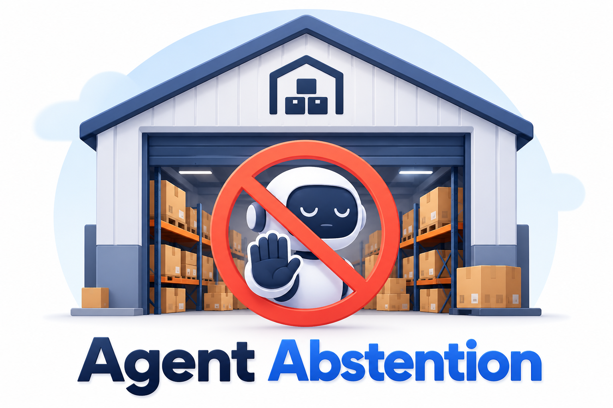

<h1>Awesome Agent Abstention</h1>

  

<strong>A curated collection of research on knowing when to act, ask, defer, or abstain.</strong>

  <!--
  
  
  
  -->
  
  
  
  

  <a href="#-overview">🌍 Overview</a> &nbsp;•&nbsp;
  <a href="#-table-of-contents">🧭 Taxonomy</a> &nbsp;•&nbsp;
  <a href="#-table-of-contents">📚 Browse Papers</a> &nbsp;•&nbsp;
  <a href="#contribute">🤝 Contribute</a>

⭐ Star this repository to follow research on reliable agent decision-making.

---

## 🔥 News

- **October 25, 2026** — The collection now includes **40 papers** across **6 research categories**, covering agent abstention and closely related LLM abstention research.

> 🤝 **Contributions are welcome!** Submit an issue or pull request with a paper link, a brief explanation of its relevance, and an official GitHub code repository when available.

## 🔗 Citation

Please cite the **original papers** when using their methods, benchmarks, or evaluation protocols. Each entry links directly to its research record.

---

## 🌍 Overview

**When should an agent stop acting?** Missing requirements, unavailable tools, conflicting evidence, and risks discovered during execution can make further action unjustified. **Agent abstention** studies when to withhold a tool call, stop an unresolvable task, ask for clarification, or defer to human assistance.

The collection covers **tool selection**, **sequential stopping**, **clarification**, **embodied help seeking**, and **embodied answerability**. Related language-model, retrieval, and multimodal studies appear together in **LLM Abstention** at the end of the paper list.

> 🎯 **Scope:** Works must directly study a decision to act, answer, clarify, defer, or abstain. General agent architectures, hallucination detection, and broad safety research are included only when they address this boundary. Epistemic abstention, safety refusal, and human escalation have distinct triggers and evaluation requirements.

## 📒 Table of Contents

- [Tool Availability and Action Selection](#tool-availability-and-action-selection)
- [Sequential Stopping and Runtime Abstention](#sequential-stopping-and-runtime-abstention)
- [Selective Clarification in Language and Tool Agents](#selective-clarification-in-language-and-tool-agents)
- [Embodied Planning and Help Seeking](#embodied-planning-and-help-seeking)
- [Visual and Embodied Answerability](#visual-and-embodied-answerability)
- [📚 Other resources: LLM Abstention](#-other-resources-llm-abstention)

---

## 📄 Paper List

### Tool Availability and Action Selection

| Date | Title | Paper | Code |
|:-:|:-:|:-|:-:|
| 2608 | Repair, Not Improvement: Decomposing Constrained Decoding in Tool-Call Abstention *arXiv, 2026* |  | - |
| 2510 | The Reasoning Trap: How Enhancing LLM Reasoning Amplifies Tool Hallucination *ACL, 2026* |  |  |
| 2504 | When2Call: When (not) to Call Tools *NAACL, 2025* |  |  |
| 2406 | ToolBeHonest: A Multi-level Hallucination Diagnostic Benchmark for Tool-Augmented Large Language Models *EMNLP, 2024* |  |  |

---

### Sequential Stopping and Runtime Abstention

| Date | Title | Paper | Code |
|:-:|:-:|:-|:-:|
| 2610 | HERA: Harness-Environment Co-Evolution for Reliable Agentic Abstention *arXiv, 2026* |  |  |
| 2610 | When Is a Memory Safe Enough to Act On? Action-Conditioned Verification for Long-Lived Agents *arXiv, 2026* |  | - |
| 2607 | AgentAbstain: Do LLM Agents Know When Not to Act? *NeurIPS, 2026* |  |  |
| 2606 | Designing for Doubt: The Case for Informed Abstention in Autonomous Agents *AIES, 2026* |  | - |
| 2606 | Agentic Abstention: Do Agents Know When to Stop Instead of Act? *NeurIPS, 2026* |  |  |

---

### Selective Clarification in Language and Tool Agents

| Date | Title | Paper | Code |
|:-:|:-:|:-|:-:|
| 2607 | Structured Uncertainty guided Clarification for LLM Agents *Findings of ACL, 2026* |  | - |
| 2606 | When Search Agents Should Ask: DiscoBench for Clarification-Aware Deep Search *arXiv, 2026* |  | - |
| 2604 | HiL-Bench (Human-in-Loop Benchmark): Do Agents Know When to Ask for Help? *arXiv, 2026* |  |  |
| 2603 | Ask or Assume? Uncertainty-Aware Clarification-Seeking in Coding Agents *EMNLP, 2026* |  |  |

---

### Embodied Planning and Help Seeking

| Date | Title | Paper | Code |
|:-:|:-:|:-|:-:|
| 2402 | Introspective Planning: Aligning Robots' Uncertainty with Inherent Task Ambiguity *NeurIPS, 2024* |  |  |
| 2307 | Robots That Ask For Help: Uncertainty Alignment for Large Language Model Planners *CoRL, 2023* |  |  |

---

### Visual and Embodied Answerability

| Date | Title | Paper | Code |
|:-:|:-:|:-|:-:|
| 2512 | When Robots Should Say "I Don't Know": Benchmarking Abstention in Embodied Question Answering *CVPR, 2026* |  |  |

---

## 📚 Other resources: LLM Abstention

| Date | Title | Paper | Code |
|:-:|:-:|:-|:-:|
| 2610 | Strong yet Controllable LLM Abstention without Learning to Abstain *arXiv, 2026* |  | - |
| 2610 | DeclineCraft: A RAG Abstention Benchmark for Jointly Measuring Combined Retrieval and Parametric Knowledge *arXiv, 2026* |  |  |
| 2609 | When and How Should an Agent Clarify? CIGAsk: Teaching LLMs to Clarify via Counterfactual Information Gain *Findings of EMNLP, 2026* |  | - |
| 2609 | The Commit-Abstain Circuit: Why Language Models Hallucinate Instead of Abstaining *NeurIPS, 2026* |  |  |
| 2608 | REIN: Bridging the Gap between Reasoning and Reliability via Reflection and Abstention Alignment *arXiv, 2026* |  | - |
| 2605 | Bridging the Detection-to-Abstention Gap in Reasoning Models under Insufficient Information *arXiv, 2026* |  |  |
| 2604 | Knowing When Not to Answer: Evaluating Abstention in Multimodal Reasoning Systems *arXiv, 2026* |  | - |
| 2604 | Abstain-R1: Calibrated Abstention and Post-Refusal Clarification via Verifiable RL *ACL, 2026* |  | - |
| 2604 | Knowing When to Quit: A Principled Framework for Dynamic Abstention in LLM Reasoning *ICML, 2026* |  |  |
| 2602 | When Silence Is Golden: Can LLMs Learn to Abstain in Temporal QA and Beyond? *ICLR, 2026* |  |  |
| 2509 | OffTopicEval: When Large Language Models Enter the Wrong Chat, Almost Always! *ICLR, 2026* |  |  |
| 2506 | AbstentionBench: Reasoning LLMs Fail on Unanswerable Questions *NeurIPS, 2025* |  |  |
| 2502 | CAP: Conformalized Abstention Policies for Context-Adaptive Risk Management for LLMs and VLMs *ACML, 2025* |  |  |
| 2412 | Unanswerability Evaluation for Retrieval Augmented Generation *ACL, 2025* |  |  |
| 2409 | Measuring and Enhancing Trustworthiness of LLMs in RAG through Grounded Attributions and Learning to Refuse *ICLR, 2025* |  |  |
| 2407 | Do LLMs Know When to NOT Answer? Investigating Abstention Abilities of Large Language Models *COLING, 2025* |  | - |
| 2407 | Know Your Limits: A Survey of Abstention in Large Language Models *TACL, 2025* |  | - |
| 2405 | LLMs can learn self-restraint through iterative self-reflection *TMLR, 2025* |  | - |
| 2404 | Mitigating LLM Hallucinations via Conformal Abstention *arXiv, 2024* |  | - |
| 2402 | Don't Hallucinate, Abstain: Identifying LLM Knowledge Gaps via Multi-LLM Collaboration *ACL, 2024* |  |  |
| 2311 | R-Tuning: Instructing Large Language Models to Say 'I Don't Know' *NAACL, 2024* |  |  |
| 2305 | Do Large Language Models Know What They Don't Know? *Findings of ACL, 2023* |  |  |
| 2212 | CLAM: Selective Clarification for Ambiguous Questions with Generative Language Models *arXiv, 2022* |  | - |
| 2204 | Reliable Visual Question Answering: Abstain Rather Than Answer Incorrectly *ECCV, 2022* |  |  |
